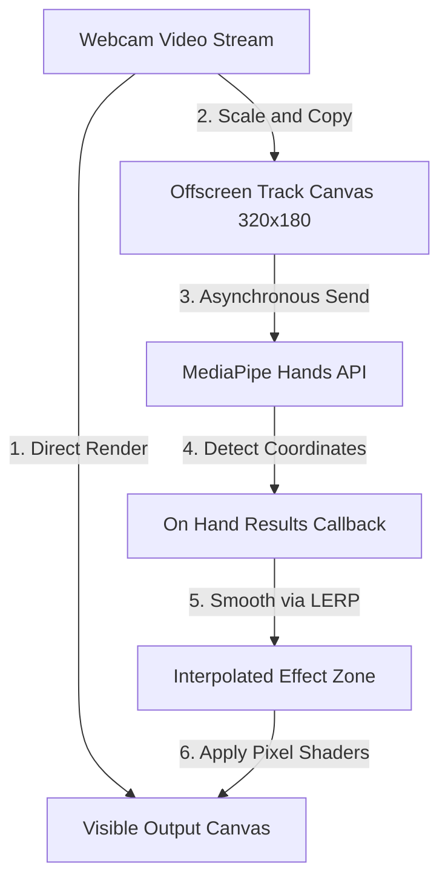

# CAMERA WITH EFFECTS

CAMERA WITH EFFECTS is a high-performance, browser-based application that implements real-time hand-tracking to isolate a localized visual effects zone. By detecting the index finger and thumb, the system dynamically calculates a bounding box in which custom pixel-level filters are processed on-the-fly.

The application features a brutalist, monospaced heads-up display (HUD) styling and relies on a decoupled architecture to ensure that computer vision tracking overhead never degrades the camera feed frame rate.

---

## Quick Start

Follow these steps to run the application locally.

### Prerequisites

* Node.js (version 16.0.0 or higher is recommended)
* A device with a connected webcam

### Installation

1. Navigate to the project directory:
   ```bash
   cd c:/Users/frosty/Projects/camera
   ```
2. Install the Express and CORS dependencies:
   ```bash
   npm install
   ```

### Running the Application

1. Start the server using the configured script:
   ```bash
   npm run dev
   ```
2. Open your web browser and navigate to:
   ```
   http://localhost:3000
   ```
3. Click "START CAMERA FEED" or "INITIALIZE CAM" and grant webcam permissions to begin.

---

## System Architecture

To prevent the heavy computational demands of hand landmark detection from throttling the display frame rate, the application implements a decoupled, asynchronous processing model.



### 1. Decoupled Frame Processing Loop
The main render loop runs inside a `requestAnimationFrame` callback. On every tick, if the webcam stream is active, the raw video frame is drawn directly to the 1280x720 output canvas. This rendering path runs completely independently of the tracking pipeline. If MediaPipe lags, drops frames, or fails to initialize, the webcam feed continues to display at a smooth, native frame rate (typically 30 or 60 FPS).

### 2. Offscreen Downscaling and Throttling
Analyzing a full-resolution 1280x720 image on every frame is computationally expensive. To optimize performance:
* The app copies the current frame to an offscreen, hidden canvas (`trackCanvas`) sized down to 320x180.
* A concurrency flag (`sending`) is set to `true` while the tracking data is being sent to MediaPipe.
* Once the promise resolves or rejects, the flag is reset to `false` in a `finally` block.
* This ensures that new tracking requests are only sent if the previous frame's tracking has completed, preventing a queue buildup.

### 3. Coordinate Smoothing via Linear Interpolation (LERP)
Raw coordinate outputs from computer vision trackers can contain high-frequency noise, which manifests as visual jitter. To solve this, the application smooths the bounding box dimensions using LERP:

\[x_{\text{smoothed}} = x_{\text{smoothed}} + (x_{\text{target}} - x_{\text{smoothed}}) \times \text{lerpFactor}\]

With a `lerpFactor` of `0.25`, the box glides smoothly to new positions, creating a fluid, professional feel as the hands move.

---

## Features

### 1. Dynamic Hand Tracking
The application uses MediaPipe Hands to detect 21 coordinates (landmarks) per hand. 
* The active zone is defined by identifying the tip of the thumb (landmark 4) and the tip of the index finger (landmark 8).
* The bounding box coordinates (`x`, `y`, `w`, `h`) are computed from the minimum and maximum X and Y coordinates of these fingertips, plus a user-configurable padding expansion.

### 2. Pixel-Level Canvas Shaders
When a bounding box is active, the app grabs the corresponding pixel data from the canvas using `ctx.getImageData()`. It then runs one of the following filters before pushing the data back with `ctx.putImageData()`:

* **Pixelate**:
  Loops through the region in grid steps defined by the pixel size slider. For each step, it samples the color of the central pixel and fills the entire block with that color, producing a retro mosaic look.
* **Distortion**:
  Creates a temporary canvas buffer of the current bounding box region. It then clips the drawing area to the box and draws horizontal slices (4 pixels tall), offsetting each slice horizontally using a sine wave formula: `Math.sin(y * frequency + animTime * 4) * amplitude`. This creates a fluid, wavy distortion effect.
* **RGB Shift**:
  Separates the red and blue channels of each pixel. It offsets the red channel to the right and the blue channel to the left by an intensity-based pixel distance, leaving the green channel in place to produce a digital chromatic aberration effect.
* **Thermal**:
  Calculates the luminance of each pixel using the formula `Y = 0.299 * R + 0.587 * G + 0.114 * B`. It normalizes this luminance to a range of 0 to 1 and maps it to a spectrum: low brightness becomes blue, medium brightness becomes green/cyan, high brightness becomes red, and peak brightness becomes white.
* **Sobel Edges**:
  Implements a Sobel kernel edge-detection operator. It convolves a 3x3 pixel grid around each pixel with horizontal and vertical Sobel kernels to calculate the intensity gradient. The resulting gradient magnitude is colored cyan and mapped to the output canvas.
* **Glitch FX**:
  Splits the vertical region into random horizontal slices. There is a random probability on each frame that a slice will be offset horizontally and wrapped around, creating a classic signal glitch appearance.
* **ASCII Matrix**:
  Draws a solid dark background inside the box, then processes the area in steps matching the grid size. The local brightness is mapped to a character from the string `@#S%*+;:,. ` and rendered on screen as green monospaced text.

### 3. Gesture-Triggered Actions
* **Pinch-to-Snap**:
  If the normalized distance between the thumb and index finger drops below `0.05`, a snapshot timer is armed. After a 400ms delay (allowing the user to reopen their fingers so they do not block the image), the application captures the canvas content. The snap is downloaded as a PNG with the pixel effects applied but without the tracking lines or brackets visible.
* **Command Gesture (Easter Egg)**:
  If a hand is detected where *only* the middle finger is extended (the wrist-to-tip distance is greater than 1.1 times the wrist-to-base joint distance) and all other fingers are curled, the browser instantly redirects to a famous music video URL.

### 4. Interactive Configuration Panel
* **Effect Intensity**: Adjusts variables like Sobel gain, RGB offset distance, or distortion amplitude.
* **Grid / Pixel Size**: Controls the grid block sizes for the Pixelate filter and font sizes for the ASCII Matrix.
* **Padding Expansion**: Increases the spacing added to the edges of the bounding box surrounding the tracked fingers.
* **Show Skeleton Landmarks**: Renders lines connecting the hand skeleton joints, with green squares marking the thumb and index tips.
* **Show Sharp Corner Brackets**: Renders tech-themed corner brackets and a dashed bounding box around the active region.
* **Invert Horizontal Mirror**: Flips the canvas horizontally to match natural mirrored webcam feedback.
* **Mouse / Touch Simulator**: Disables webcam hand tracking entirely, enabling users to click and drag on the canvas to manually position and scale the effect zone.

---

## File Structure

```
├── app.js              # Main camera, gestures, and effects logic
├── index.html          # HUD interface layout
├── style.css           # Brutalist typography and stylesheet definitions
├── public.zip          # Packaged archive of the web assets
└── README.md           # Documentation file
```

---

## Contact

* a project by @enafrosty
* Website: https://heyfrosty.space
* Email: iyad@heyfrosty.space

